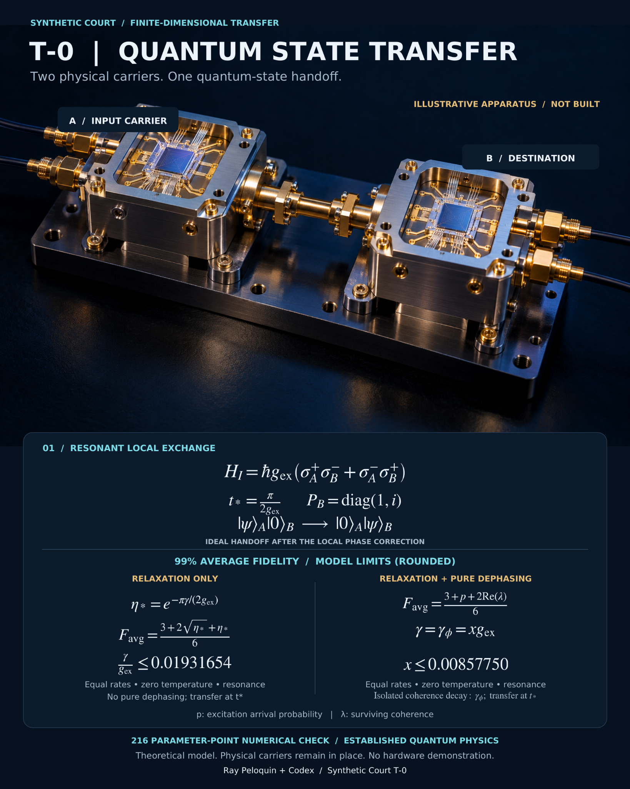

# T-0 | Quantum State Transfer

**Two physical carriers. One quantum-state handoff.**

A concept board illustrating resonant local exchange between an input carrier A and a destination carrier B, with a local phase correction at the destination.

**Status:** Theoretical model and illustrative apparatus. Not built; no hardware demonstration. The physical carriers remain in place.

The board presents theoretical average-fidelity limits under its stated assumptions, including equal rates, zero temperature, and resonance. These values are model results rather than measured hardware performance. This presentation contains the concept image; underlying numerical-check code and data are not included.

**Credit:** Ray Peloquin + Codex / Synthetic Court T-0.
